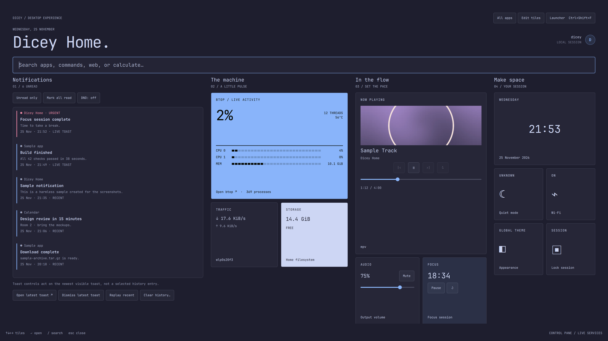
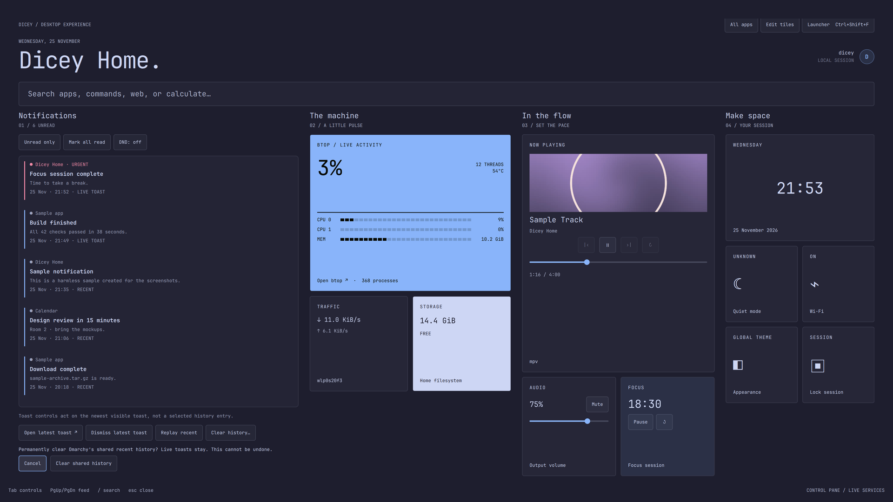
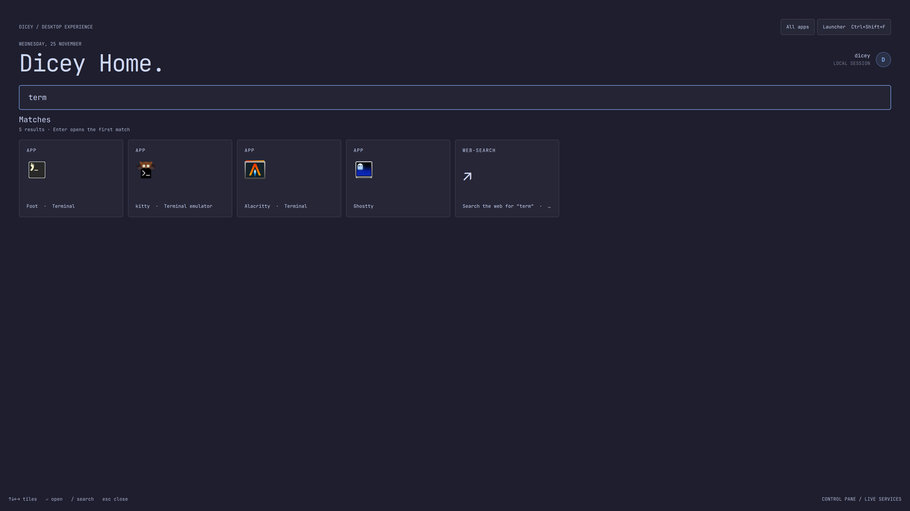
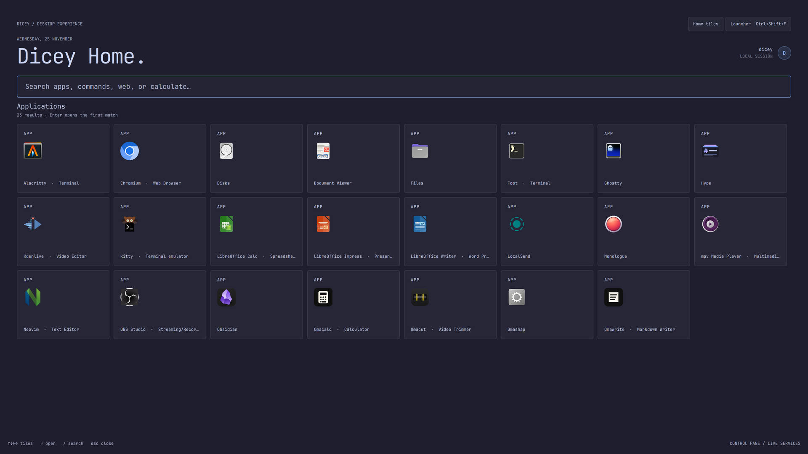
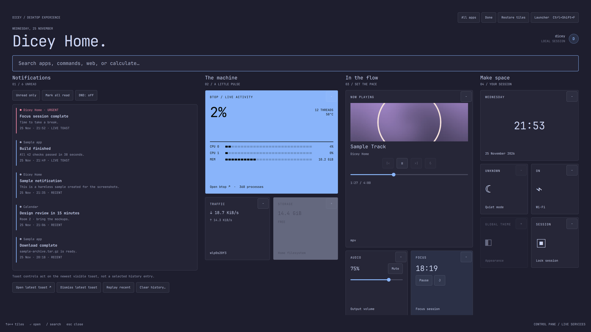
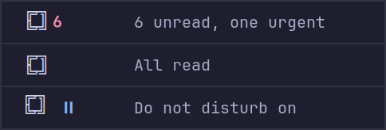

# Dicey Home

**A full-screen notification hub and themed command palette for Omarchy:** read
and filter notifications, launch apps, search the web, calculate, and control
media, volume and your session from one keyboard-driven surface that follows
your Omarchy theme.

[](https://github.com/dicey-dev/dicey-home/releases)
[](LICENSE)
[](https://plugins.omarchy.org/)


**Alpha software (0.x).** The tagged baseline is **v0.1.0**, before the
notification work. Notifications on `main` are unfinished, untagged development;
they are not a released or marketplace-ready feature. Compatibility may change.
Omarchy updates follow `main`, not tags, so an ordinary update includes that WIP.

The plugin ID is **`dicey.home`**. This is an independent repository; no other
Dicey checkout, installer, or synchronization service is required.

## Screenshots

| | |
|---|---|
|  |  |
| **Home.** The resting dashboard: notification feed, live activity, MPRIS media, output volume, focus timer and session tiles. | **Notifications.** Keyboard focus in the feed controls, with the shared-history clear confirmation open (Cancel is focused by default). |
|  |  |
| **Search.** Typing switches the board to result tiles: ranked apps, then a web search through the default browser's engine. | **All apps.** The stock application library as icon tiles. |
|  |  |
| **Edit tiles.** Hide/show controls on every tile; hidden tiles dim while editing. | **Bar icon.** Unread count (urgent color when an urgent notification is unread), all read, and the DND pause marker. |

Screenshots are rendered offscreen from this repository's QML with sample data:
the notifications, media track, user name and app list are placeholders, not a
real session. Activity numbers are live readings from the capture machine.

## Features

- **Notification hub.** The existing Home bar icon shows an unread count (up to
  **99+**), urgency and DND status. Click it to open Home at **Notifications**.
  Read the newest live/recent entries, filter unread, explicitly mark all read,
  toggle DND, or use the host's latest-toast/replay controls. Clearing shared
  history requires confirmation; opening Home never marks or deletes
  notifications. See [notification behavior and host limitations](docs/notifications.md).
- **Command palette.** A 720-logical-pixel command palette for Omarchy's
  existing application/menu launcher, with the stock ranking, routes, menu
  actions, app uninstall and dmenu behavior intact.
- **Dicey Home.** Press **Ctrl+Shift+F** inside the launcher to toggle a native
  tile dashboard covering the entire display and bar, with real activity
  monitoring, MPRIS media controls, output volume/mute, a focus timer, and
  session actions. Layout and tile visibility are remembered across opens and
  shell restarts.
- **Web search and calculator.** Web searches use the default browser's
  configured search engine, including custom URL engines such as Unduck.
  Preview results come only from that engine; providers without usable previews
  still open through the browser. Chromium-family settings are read-only;
  Firefox-family searches use native browser search. Arithmetic such as
  `24 * 7` or `sqrt(144)` is answered inline and copied on Enter.
- **Profile header.** The header includes your username and a circular portrait.
- **Live theming.** Colors, fonts, borders, spacing, and rounding follow the
  live global Omarchy theme. Existing menu IPC and shortcuts route to this clone.

Source, design, installation, and behavior are documented in
[`docs/dicey-home.md`](docs/dicey-home.md).

## Install

```bash
omarchy plugin add https://github.com/dicey-dev/dicey-home.git
omarchy plugin enable dicey.home
```

Uses the installed Omarchy menu, Quickshell/MPRIS, `wl-copy`, Python 3
(standard library only), `pactl`, `nmcli`, XDG tools, and `notify-send`. `btop`,
and `ncdu` controls honor availability.

## Configuration

- **Layout.** Ctrl+Shift+F (or the launcher's layout control) switches between
  the compact palette and Dicey Home; the choice is saved.
- **Tiles.** **Edit tiles** hides or shows individual tiles; **Restore tiles**
  brings back the default set.
- **Portrait.** The header uses `~/.config/omarchy/launcher-avatar` or your
  standard user-profile image, with a theme-colored initials badge when no photo
  is available.
- **Search engine.** Change it in your default browser; the launcher re-reads it
  each time it opens.
- **Automation.** `omarchy-shell shell call dicey.home toggleHome ''` and the
  other IPC calls are listed in [`docs/dicey-home.md`](docs/dicey-home.md).

Preferences live under `$XDG_STATE_HOME/omarchy/dicey.home` (default
`~/.local/state/omarchy/dicey.home`).

## Compatibility, updates and privacy

Tested on **Omarchy 4.0.6 / Quattro, Qt 6.12 and Quickshell 0.3.2**. The installed
menu is adapted with checked anchors; an unsupported upstream menu falls back
to its stock implementation instead of applying a partial transformation.
Other Omarchy releases are not yet a tested compatibility promise.

```bash
omarchy plugin update dicey.home
```

Omarchy fetches `origin HEAD` (the remote default branch) and fast-forwards the
installed checkout, even when detached; it does not choose a tag based on SemVer.
See [Releases and marketplace checklist](docs/publishing.md) for releases, rollback limitations
and migrating a manually copied install. The clone-source metadata deliberately
keeps existing `omarchy.menu` shortcuts and stock-menu restoration working.

No build, privilege elevation, background installer, additional daemon or remote
build is required. Omarchy normally supplies the runtime tools; optional tiles
are unavailable when their applications are absent. `pactl` comes from
`libpulse`, `nmcli` from `networkmanager`, `wl-copy` from `wl-clipboard`, and
`notify-send` from `libnotify`. XDG helpers and a configured default browser are
needed for browser/file actions. See [Security boundaries](docs/security-review.md):
search queries may go to your configured engine while typing, browser search
preferences are read-only, and avatars/media artwork come from your session.
Notification text is read locally from Omarchy's existing snapshot files; it is
not sent over the network or duplicated into another history database. One
shell-owned Python helper watches those files while Home is loaded. Only a read
watermark is stored in Home's own preferences. Notification content renders as
plain text; sender images, URLs and stored commands are not loaded or executed
by the feed. Explicit toast actions are delegated to the host via public IPC.

### Known issues on newer hosts

Observed on Omarchy 4.5.0 (Qt 6.12, Quickshell 0.3.2), outside the tested range:

- Some Home QML refers to theme colors as `Color.menu.*`. On this Qt build the
  bare name resolves to Qt's own `Color` type, so the dashboard can render with
  a light background and dark tiles instead of the theme. The screenshots above
  qualify these names as `Commons.Color.*` to show the intended theming.
- The notification reader expects Omarchy 4.0.6's per-notification snapshot
  files; newer hosts store history differently, so the feed can stay empty.
- The Quiet mode tile can show **UNKNOWN** where the host no longer offers the
  `dndState` notification call.

## Rollback and removal

Restore the stock menu with `omarchy plugin enable omarchy.menu`, then use
`omarchy plugin remove dicey.home`. Preferences live outside the checkout
under `$XDG_STATE_HOME/omarchy/dicey.home` (default `~/.local/state/omarchy/dicey.home`)
and are intentionally preserved.

## Development and hot reload

From any checkout (not the installed production folder):

```bash
tests/run.sh
tests/run.sh --compat
omarchy plugin validate .
scripts/dev.py start
# Ctrl+C stops watching and restores the previously enabled menu.
```

Tests use `python3` and `node` from `PATH`, with no npm/pip dependencies or
hardcoded interpreter paths in the test runner. Node is test-only. Installed
Python helpers remain a separate runtime dependency. Internal dashboard
components live in `home/`, following the feature-folder organization used by
[Omaplug](https://github.com/fross100/omaplug).

`tests/run.sh --compat` uses the installed Omarchy menu source. The separate
`tests/verify_*.py` checks operate the real desktop and may restart the shell;
run them only deliberately in an idle graphical session.

Development runs as `dicey.home.dev`, with separate preferences and without
modifying installed `dicey.home` files. No background watcher is installed.
See [Development](docs/development.md) for hot reload, recovery and production updates.

## Docs and license

- [Dicey Home design and behavior](docs/dicey-home.md)
- [Notification hub](docs/notifications.md)
- [Development](docs/development.md)
- [Security boundaries](docs/security-review.md)
- [Releases and marketplace checklist](docs/publishing.md)
- [Changelog](CHANGELOG.md)

Dicey code is Apache-2.0; adapted Omarchy portions remain MIT. Preserve
[`LICENSE`](LICENSE) and [`THIRD_PARTY_NOTICES.md`](THIRD_PARTY_NOTICES.md).
Marketplace approval is separate from local validation and is not a security audit.
